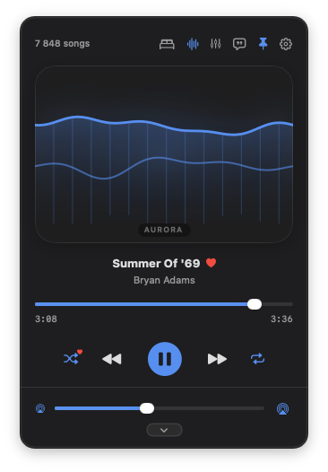
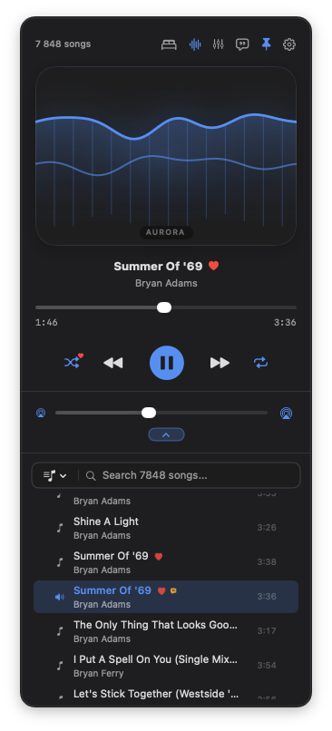
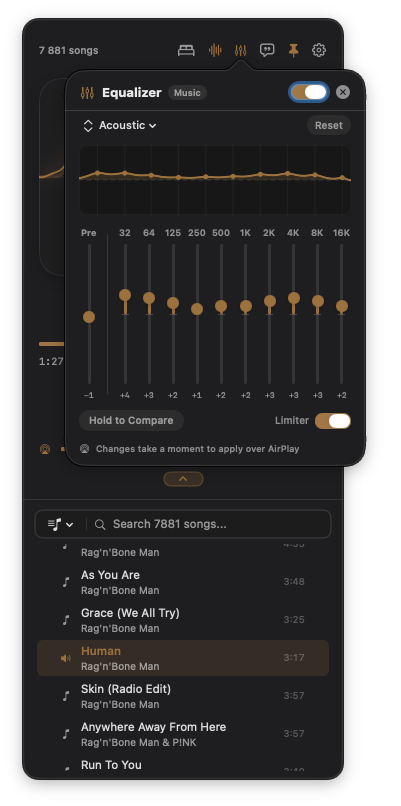
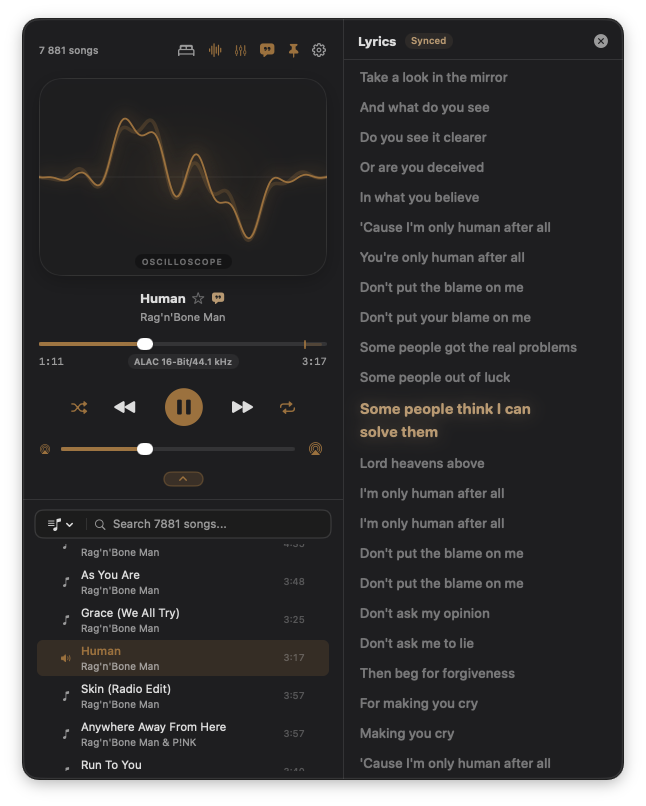

# Echo — A Modern Audio Player for macOS

> **Official Website**: [https://disfiguredfanny.github.io/Echo-a-Modern-Player-for-macOS/](https://disfiguredfanny.github.io/Echo-a-Modern-Player-for-macOS/)  
> **Download Latest**: [Echo 3.0 Releases](https://github.com/DisfiguredFanny/Updates/releases/latest)

Echo is a lightweight menu bar and desktop audio player for macOS. It plays your own DRM-free music files: your locally stored library managed by the Music app, downloaded Apple Podcasts episodes, or any folder of audio files. Built natively in Swift, SwiftUI, and AppKit.

  
  
  
  

## Highlights

- **Lossless & Standard Formats** — MP3, AAC, M4A, ALAC, FLAC (native tag/cover reader), AIFF and WAV.
- **Audiophile 10-Band EQ** — Octave-spaced peaking bands (32 Hz – 16 kHz), dynamic peak limiter, transparent clip guard, 11 built-in presets, and hold-to-compare.
- **Loudness-Linear Crossfade** — Dual-player engine with 6–12s crossfades; artwork transitions in exact sync with the audio.
- **Synced Karaoke Lyrics** — Real-time lyrics drawer tracking local `.lrc` / `.txt` files, embedded ID3 tags, and online APIs.
- **High-Performance Library** — `NSTableView`-backed list with cell recycling for 120 FPS ProMotion scrolling and 0.0% idle CPU.
- **AirPlay 2 & Direct Device Routing** — Output directly to Bluetooth, USB, HDMI or AirPlay with separate Mac and AirPlay volumes.
- **Smart Compilation Recognition** — Resolves actual song performers instead of cluttering your library under *Various Artists*.

## Requirements

- macOS 15 Sequoia or later
- Universal binary (Apple Silicon & Intel)
